# Cérebro do Projeto

[](../../actions/workflows/testes.yml)


**O painel de gestão dos seus projetos do Claude Code, no seu computador.** O Cérebro do Projeto mostra num lugar só quem está
trabalhando agora (sessões e subagentes), o que cada agente entregou e se alguém já conferiu, o que foi decidido, quanto está custando,
o mapa do código e as ferramentas de qualidade. Ele também guarda cópia das suas conversas e da memória, avisa no Windows quando algo
precisa de você e deixa você passar tarefas para a conversa principal (o "gestor"). Tudo roda na sua máquina: sem conta, sem nuvem,
sem telemetria.

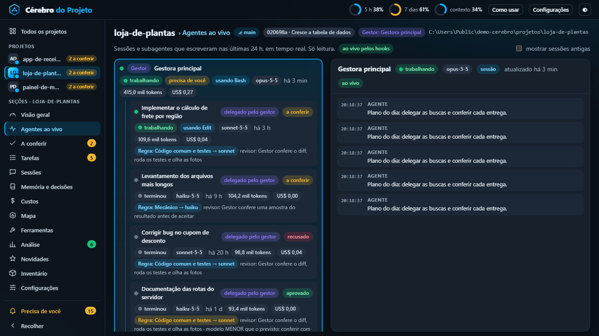

> Quer ver antes de instalar nos seus projetos? Rode `python demo/rodar_demo.py`: o Cérebro sobe com **dados inventados** (três
> projetos de exemplo) e não usa nada seu. Todas as fotos desta página vêm dessa demonstração.

*Resumo em inglês no fim da página — [English summary](#english-summary).*

## Sumário

- [Para quem é](#para-quem-é)
- [O que ele faz](#o-que-ele-faz)
- [Instalação](#instalação)
- [Primeiro uso](#primeiro-uso)
- [O que ele mexe no seu PC](#o-que-ele-mexe-no-seu-pc)
- [Segurança e privacidade](#segurança-e-privacidade)
- [Atualizar e desinstalar](#atualizar-e-desinstalar)
- [Perguntas frequentes](#perguntas-frequentes)
- [Limites conhecidos](#limites-conhecidos)
- [Como contribuir](#como-contribuir)
- [Licença e créditos](#licença-e-créditos)

## Para quem é

Para quem usa o [Claude Code](https://claude.com/claude-code) em um ou mais projetos, programador ou não. A ideia do Cérebro é
**trabalhar com agentes sem perder o controle**:

- uma conversa principal, a **gestora** (você + o melhor modelo), divide o trabalho pesado entre modelos menores (Haiku, Sonnet);
- **tudo** o que eles entregam entra numa fila "a conferir" e só vale depois que a gestora confere;
- as decisões, a memória e o mapa do projeto ficam guardados, para nenhuma conversa nova começar do zero.

Qualidade primeiro; a economia de tokens vem da memória que fica, não de pular a revisão.

Você não precisa saber programar para usar o painel: ele é todo em português, explica cada botão e nada acontece sem o seu clique.

## O que ele faz

### O painel

Novo na 1.3.0, o painel tem o jeito de um **dashboard**: uma **barra lateral à esquerda** (todos os projetos, a lista de projetos com o selo
"a conferir", as seções do projeto aberto com contadores e, no pé, **Precisa de você**) e uma **área principal que cabe na tela sem
rolar**: telas longas viram abas internas, menus de seções ou páginas numeradas. Na barra de cima ficam os anéis de limite, *Como usar*
e *Configurações*. A barra lateral recolhe para ícones; em janela estreita (ou no celular) ela vira um menu ☰.

### Acompanhar o trabalho

**Painel geral** — um cartão por projeto (pasta, ramo, último commit, custo de hoje e da semana, gestora, a conferir) e a faixa
"Cérebro atualizado" quando sai versão nova. **Precisa de você**, no pé da barra lateral, mostra quantas pendências há e abre uma gaveta
com tudo o que espera uma decisão sua: trabalho a conferir, tarefas paradas, memória a revisar, orçamento perto do limite, backup
atrasado, cada uma com **Abrir**.

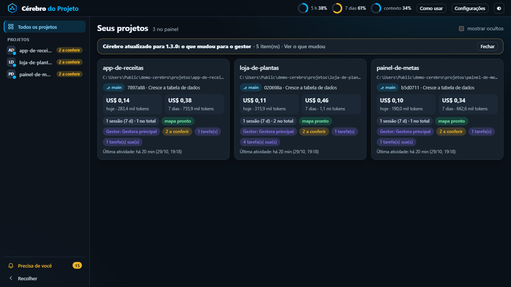

**Agentes ao vivo** — a árvore sessão → subagentes, com estado (trabalhando, parado, terminou), modelo, tokens e o passo a passo de
cada um. Com os **ganchos** do Claude Code ligados (opcional, com o seu sim), o estado muda **na hora** e aparecem "usando Edit",
"precisa de você" e os **anéis de limite** de 5 horas e da semana na barra de cima (foto do começo desta página). Com eles ligados, o
Cérebro também fica no ar enquanto o Claude Code manda eventos, mesmo sem a página aberta; se estiver fechado (por exemplo, depois de
reiniciar o PC), o próprio gancho o liga em segundo plano, sem janela, no máximo uma vez a cada 2 minutos (o evento daquele instante se
perde, os próximos chegam).

**A conferir** — todo subagente que termina espera aqui até a gestora marcar *aprovado*, *corrigido* ou *recusado*. Mostra quanto
cada modelo acerta de primeira.

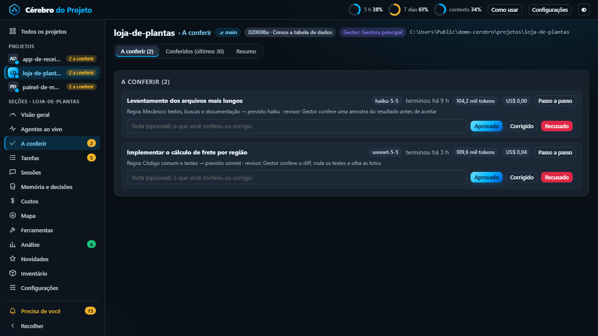

**Sessões e a gestora com conversa longa sem toque** — todas as conversas do projeto, com título melhor, tokens e custo. A gestora
**nunca é trocada**. Quando a conversa dela enche, o Claude Code compacta sozinho: antes, o Cérebro grava um **capítulo** (onde parou,
o último pedido e a pergunta pendente, pendências, pasta de trabalho e ramo, o que foi feito, decisões, arquivos) e, logo depois,
devolve o resumo à gestora. Você não precisa fazer nada. Existe também a **limpeza na mesma sessão** (a gestora limpa a conversa e o app
pede o seu ok), mas ela vem **desligada** (liga em Configurações): depois da limpeza a conversa só recomeça quando você manda uma
mensagem. A seção Sessões mostra a corrente da gestora, a linha do tempo dos capítulos e a lista de conversas. Conversa longa ganha o botão **Gerar resumo** ("passa-bastão", sem IA).

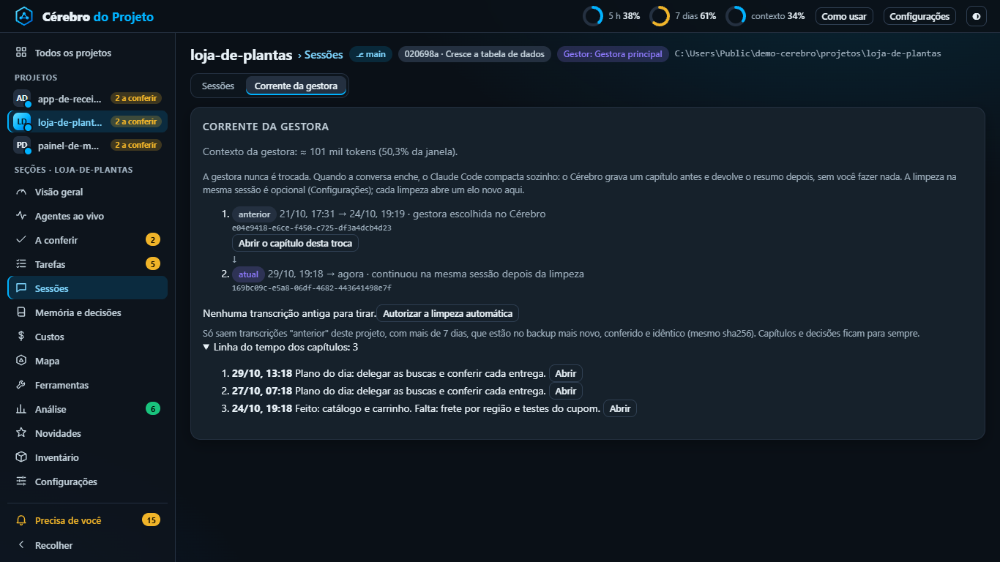

### Dar trabalho ao gestor

**Tarefas** — escreva o que você quer (título, descrição, prioridade, tipo de agente) e a gestora recebe como contexto da conversa.
Cada tarefa tem estado (nova, recebida, em andamento, a conferir, feita, recusada) e histórico.

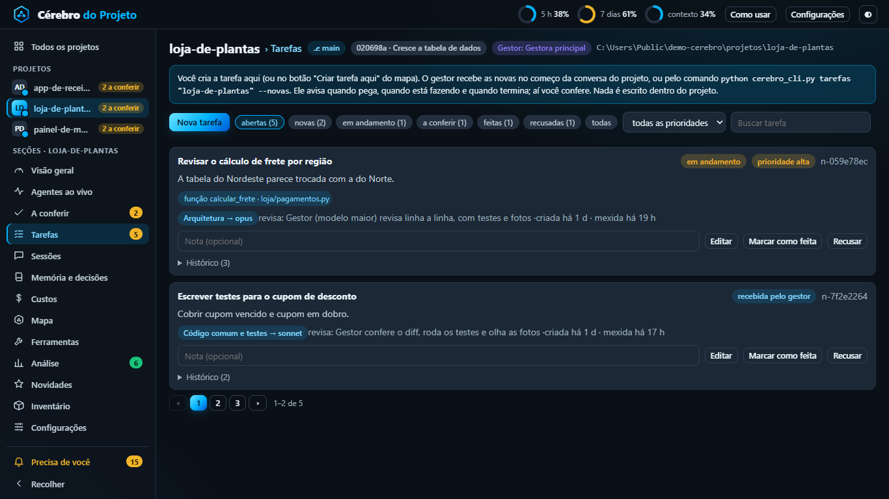

**Criar tarefa direto no mapa** — clique numa função, arquivo ou grupo do mapa do código e use **Criar tarefa aqui**: a tarefa já vai
com o lugar certo do código.

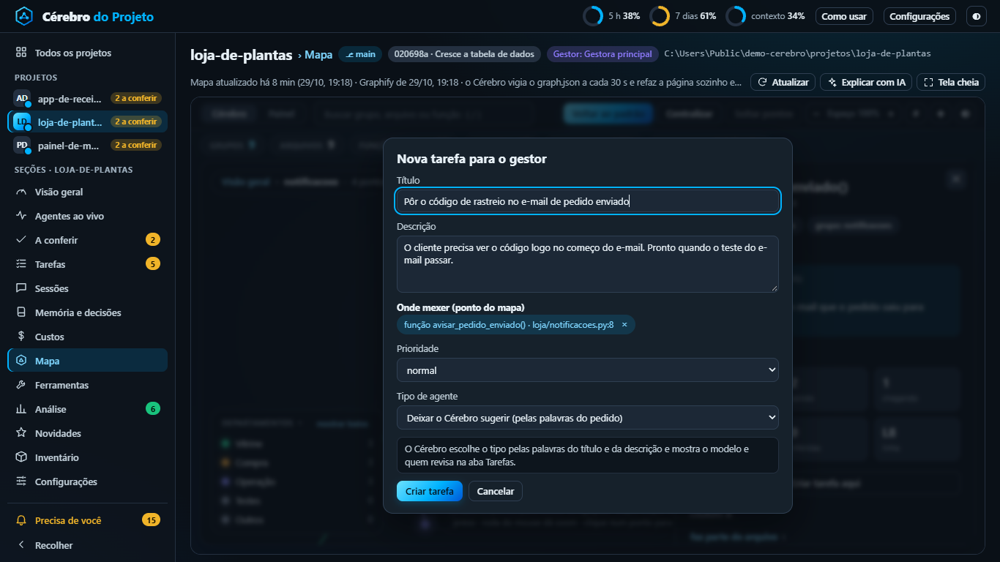

**Manual do gestor** — o Cérebro escreve um manual curto (`~/.cerebro/GESTOR.md`, menos de 1.500 tokens) com os comandos, como delegar
e conferir e o que fazer em conversa longa. Ele é refeito a cada versão e a página avisa "Cérebro atualizado". Em Configurações do projeto,
**Manual do gestor neste projeto** faz o Claude Code ler o manual sozinho (um bloco no `CLAUDE.local.md`, que fica fora do git).

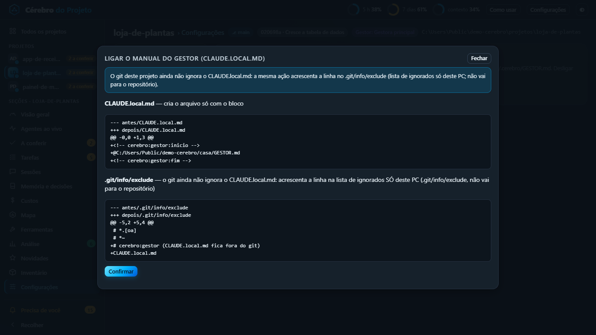

### Memória e decisões

Em abas internas: os itens de memória do Claude Code do projeto, a **linha do tempo de decisões e regras**, **Cuidar da memória** e o
**contexto fixo** (os tokens que toda conversa paga antes de começar). Você pode **editar, criar e arquivar** memórias pela página (arquivar move, nunca apaga), ver **avisos** de memória
velha ou que cita arquivo que não existe mais e **compactar o índice** `MEMORY.md` sem IA, com um verificador que garante que nenhuma
regra some.

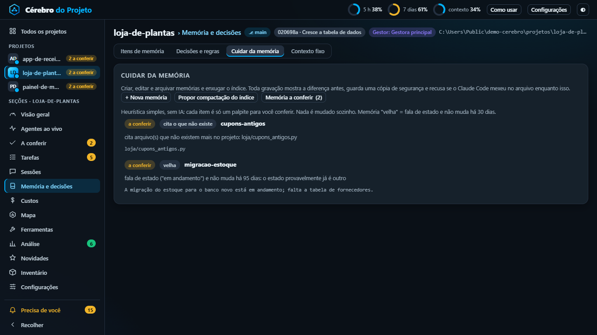

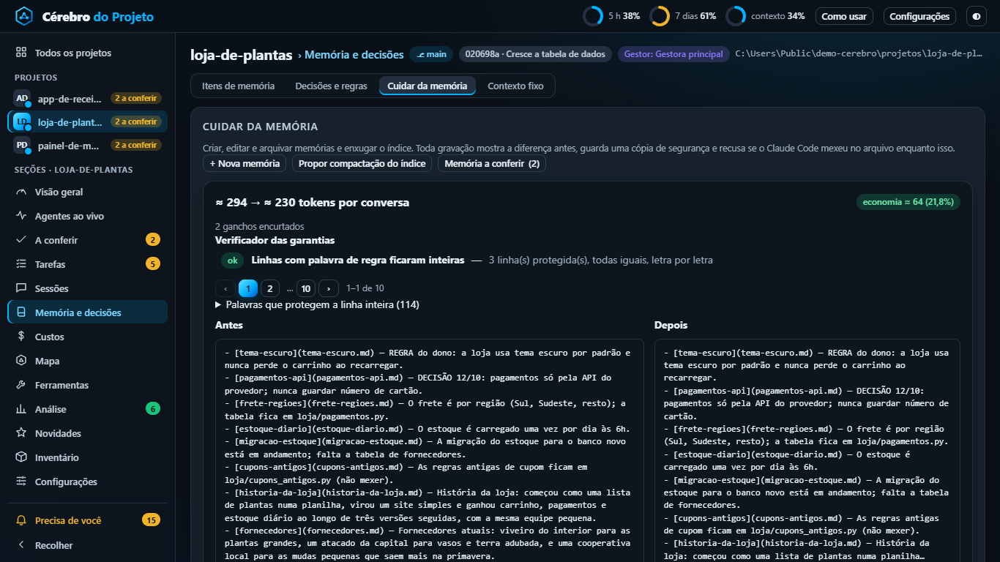

### Custos e orçamento

Tokens e custo estimado por modelo, sessão, subagente e dia (preço de lista, editável; pode diferir da sua fatura). O **orçamento**
define limites em US$ por dia, semana e mês, por projeto e geral, com barra, projeção do mês e aviso a partir de 80%. O Cérebro só
avisa; nunca bloqueia. Na seção Custos, o gráfico por dia, o orçamento e as tabelas por modelo, sessão e subagente ficam em abas internas.

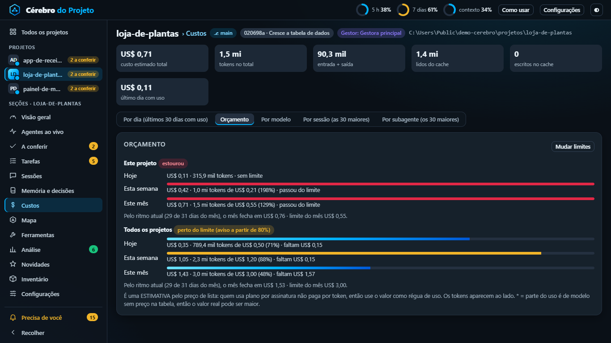

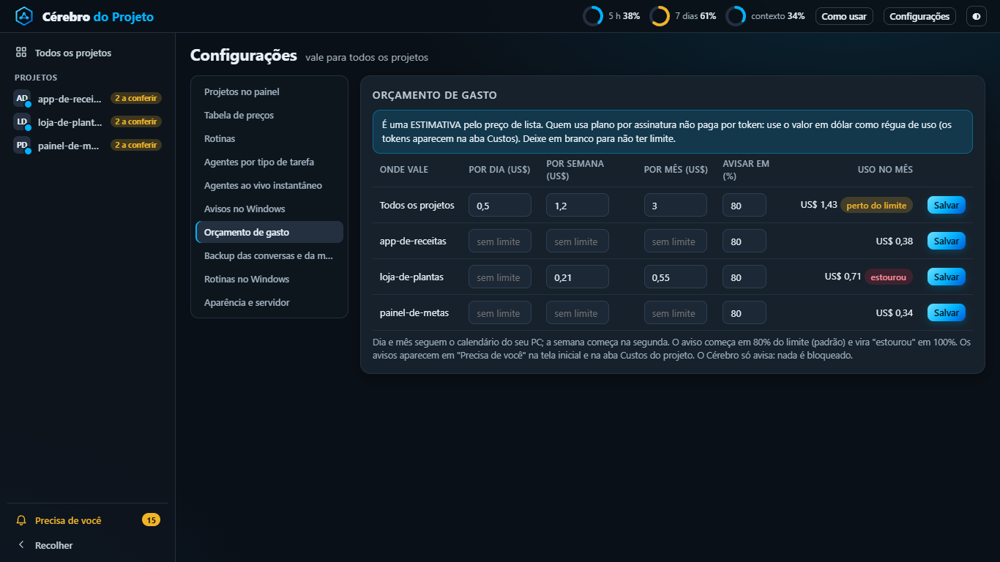

### Mapa do código

O grafo do código **ocupando a área do meio inteira**, em departamentos coloridos, com painel de leitura e linha do tempo; se refaz
sozinho quando o `graph.json` muda. O controle **− Espaço +** afasta ou aproxima as bolinhas (fica lembrado), *Centralizar* enquadra
tudo e *Tela cheia* abre o mapa sozinho. O motor é o [Graphify](https://github.com/safishamsi/graphify) (opcional, instalado à parte).
O botão **Explicar com IA** abre uma gaveta que pede ao Haiku uma frase simples para os pontos que não têm texto no código: mostra antes quantos tokens vai gastar, só roda quando você
clica e a frase aparece marcada como "explicação automática (IA)".

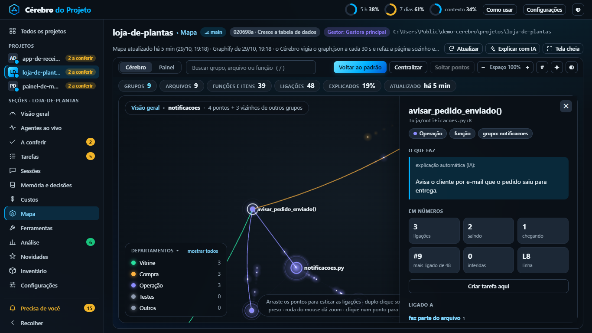

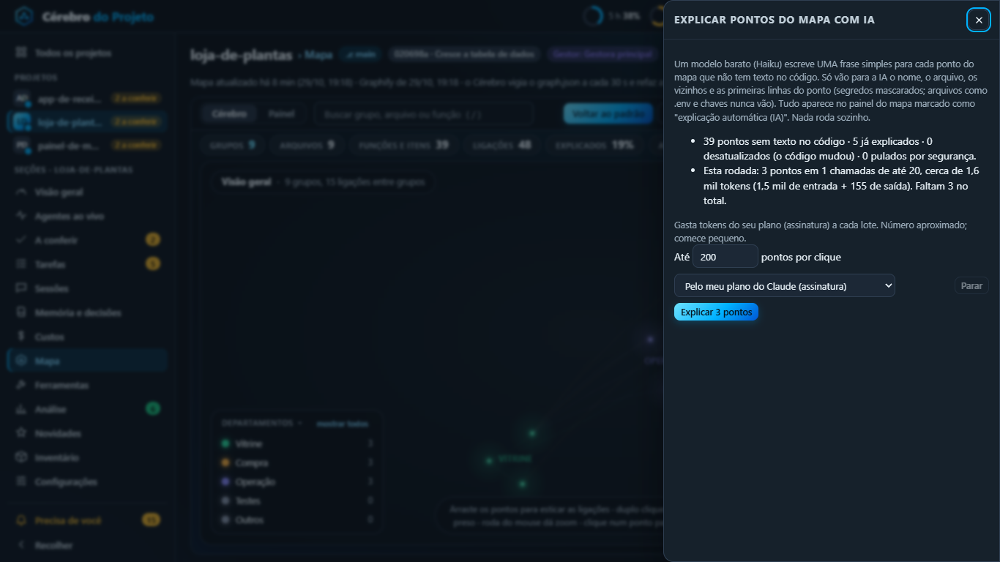

### Qualidade do projeto

**Ferramentas** — mostra o que está instalado (ruff, ESLint, cargo/clippy, gitleaks, Semgrep, pip-audit, cargo-deny, OSV-Scanner,
coverage, Lighthouse), sugere comandos para o seu projeto (testes, lint) e roda só os que você aprovou, com o seu clique. O botão
**Instalar…** instala as que faltam por uma receita fechada, mostrando antes o comando exato, de onde vem e onde instala.

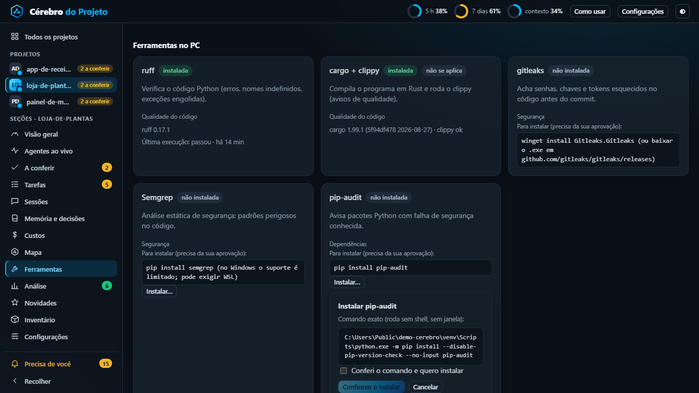

**Análise** — *Analisar agora* (sem IA) monta um relatório e **propostas** (motivo, esforço, risco). Você aprova ou descarta; a aprovada
vira tarefa para o gestor.

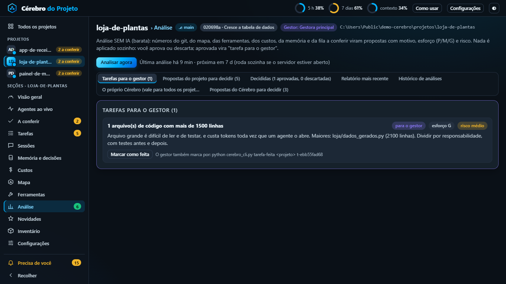

**Novidades** — procura, quando você clica, versões novas do Claude Code, do Graphify e das ferramentas em páginas públicas do GitHub.

**Inventário e encaixe** — o que o projeto já tem (instruções, testes, lint, CI, ganchos, agentes, memória, mapa) e um **plano de
encaixe**: cada item mostra antes os arquivos e a diferença, só cria ou acrescenta (nunca reescreve), guarda cópia e tem **Desfazer**.
Inclui copiar os **agentes por tipo de tarefa** (mecânico → Haiku, código comum → Sonnet, crítico → Opus) para `.claude/agents`.

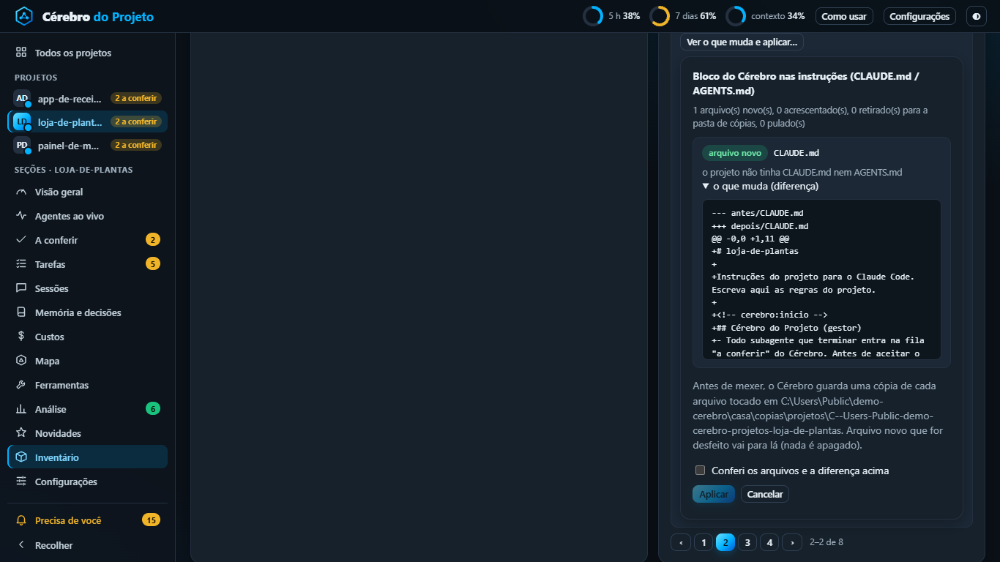

### Proteção e rotina

**Backup e restauração** — um `.zip` por dia com as conversas e a memória de todos os projetos (e os dados do Cérebro), guardado
**fora** das pastas do Claude Code e do Cérebro (padrão `~/CerebroBackup`). Guarda 7 dias, confere cada cópia e protege a boa se a nova
vier bem menor. **Restaurar** mostra o que falta, o que mudou e o que só cresceu; devolve o que falta e só troca o resto se você marcar.
Nada é apagado.

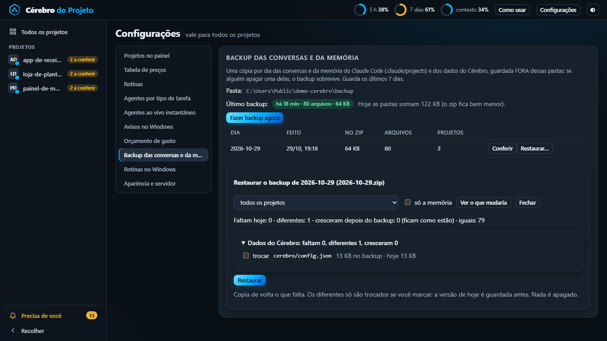

**Rotinas no Windows** — backup, análise, novidades e mapa rodando sozinhos pelo Agendador de Tarefas, mesmo com o painel fechado
(só se você ligar; só tarefas da pasta `CerebroDoProjeto`).

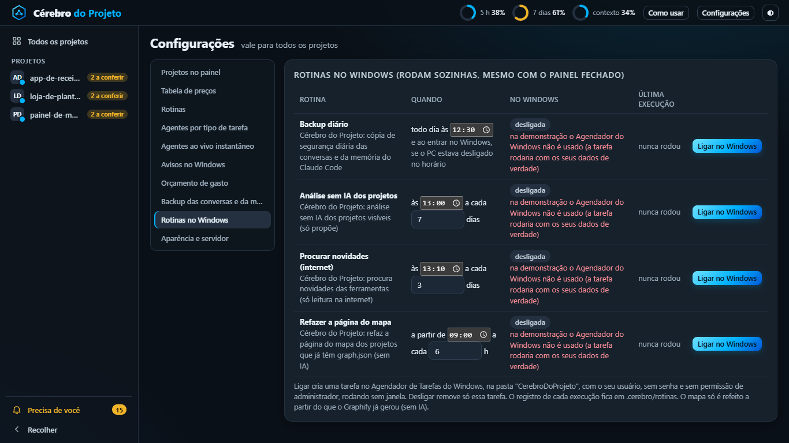

**Agentes ao vivo instantâneo e Avisos no Windows** — em Configurações, cada assunto tem a sua seção no menu da esquerda. Ligar os ganchos mostra a diferença exata no `settings.json` do Claude Code, faz
cópia antes, preserva o que você já tinha e tem **Desligar**. Os avisos aparecem na tela do Windows quando chega item a conferir, quando
o Claude Code precisa de você, quando uma sessão longa termina e quando o gasto passa do limite (com "não perturbe" e botão de teste).

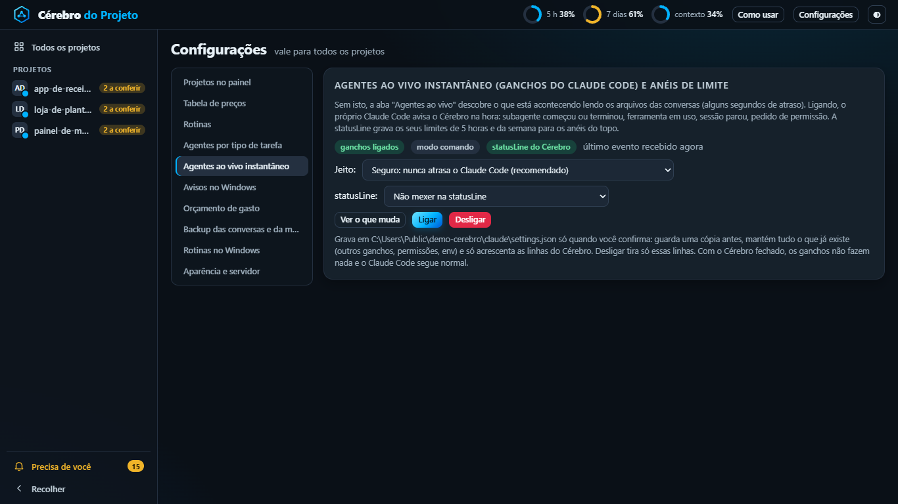

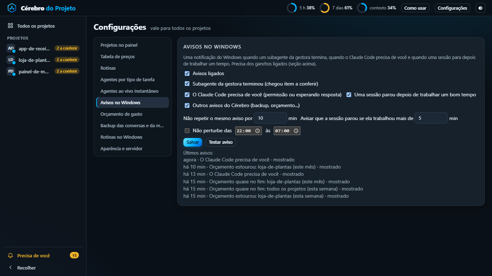

### E também

- **Configurações** — um menu de seções à esquerda: sessão gestora e apelido, projetos visíveis, preços, rotinas, agentes por tipo de
  tarefa, departamentos do mapa, ganchos, avisos, orçamento, backup, rotinas no Windows, manual do gestor, tema, porta.
- **Primeiro uso guiado** — a tela *Bem-vindo* conduz os primeiros passos (veja abaixo).
- **Como usar** — o guia completo dentro do painel (botão na barra de cima).
- **Celular / janela estreita** — a barra lateral vira um menu ☰ e a página rola, sem rolar para o lado.
- **Linha de comando do gestor** — `python cerebro_cli.py …` funciona com o painel fechado (lista na [referência](docs/referencia.md)).
- **Verificação automática no GitHub** — a cada envio, ruff, a suíte de testes e uma prova do instalador num PC limpo, no Windows e
  no Linux (`.github/workflows/testes.yml`).

## Instalação

### O que você precisa

| Requisito | Detalhe |
|---|---|
| Sistema | **Windows 10 ou 11** (o principal: atalho na área de trabalho, rotinas e avisos do Windows). macOS e Linux funcionam; veja abaixo o que muda. |
| Python | **3.11 ou mais novo** ([python.org](https://www.python.org/downloads/)). O instalador cria um ambiente `.venv` só para o Cérebro. |
| Claude Code | O Cérebro lê as conversas e a memória que o Claude Code guarda em `~/.claude/projects`. Sem conversas, o painel abre vazio. |
| Git | Opcional: para baixar com `git clone` e para mostrar ramo e último commit. |
| Graphify | **Opcional**: só para o mapa do código. O instalador oferece instalar (sempre perguntando). |

### Windows, passo a passo

1. **Instale o Python** pelo [python.org](https://www.python.org/downloads/). Na primeira tela do instalador, marque
   **"Add python.exe to PATH"**.
2. **Baixe o Cérebro.** Nesta página do GitHub, clique no botão verde **Code**:
   - com Git: copie o endereço e rode `git clone <endereço copiado>`;
   - sem Git: clique em **Download ZIP** e descompacte numa pasta sua (por exemplo, `Documentos\cerebro-do-projeto`).
3. **Abra o terminal na pasta.** No Explorador de Arquivos, abra a pasta do Cérebro, clique na barra de endereço, digite `cmd` e aperte
   Enter.
4. **Rode o instalador:**

   ```
   python instalar.py
   ```

   Ele explica cada passo na tela e pode ser rodado de novo sem estragar nada:
   1. confere o Python;
   2. cria o `.venv` e instala as dependências (`requirements.txt`, versões fixas);
   3. oferece instalar o Graphify (opcional);
   4. cria a pasta de dados `~/.cerebro`;
   5. oferece ligar os **ganchos do Claude Code** (recomendado): mostra a diferença no `settings.json` e só grava com o seu "sim" na hora;
   6. pergunta se cria o atalho **Cérebro do Projeto** na área de trabalho;
   7. abre o painel.

   Opções: `--sim` (aceita as perguntas, menos os ganchos), `--nao` (só o essencial), `--sem-venv` (instala no usuário), `--sem-abrir`.
5. **Abra o painel** pelo atalho **Cérebro do Projeto** (ou `abrir_cerebro.bat`). O navegador abre em `http://127.0.0.1:8188/` já com a
   chave de acesso.

### macOS e Linux

```
git clone <endereço do repositório>
cd cerebro-do-projeto
python3 instalar.py
./abrir_cerebro.sh
```

Funciona: o painel inteiro, a demonstração, a linha de comando, backup e restauração, ganchos e statusLine do Claude Code, orçamento,
encaixe e explicação por IA. Não tem: o atalho automático (o instalador explica como criar um), as **Rotinas no Windows** (mostram
"só no Windows"; com o painel aberto, análise e novidades continuam rodando no prazo) e os **avisos na tela** (só ficam registrados).

## Primeiro uso

Na primeira vez o painel mostra a faixa **Primeiro uso**. Ela leva à tela *Bem-vindo*, que guia os passos: seus projetos, a **sessão
gestora** de cada um, **gerar o mapa** (o Graphify roda dentro do projeto *só quando você clica*), os **comandos sugeridos**, os
**ganchos** (recomendado) e pronto. Dá para pular o que quiser e voltar depois.

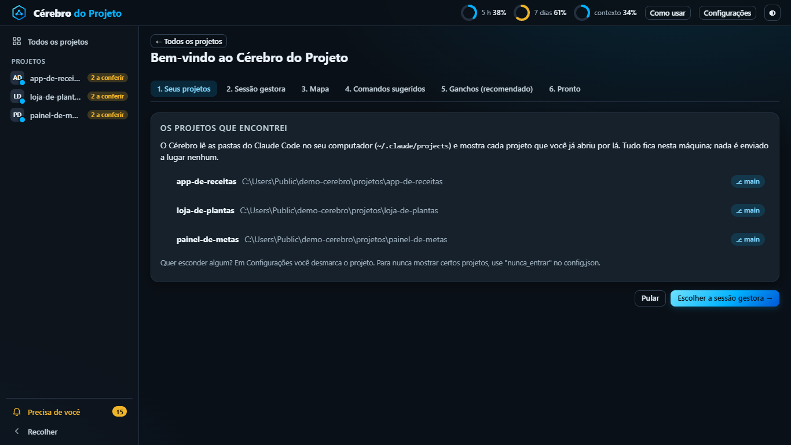

Sugestões para começar bem:

1. Escolha a **sessão gestora** de cada projeto (Configurações do projeto) e dê um apelido.
2. Em Configurações, faça um **backup agora** e, no Windows, ligue a rotina de **backup diário**.
3. Ligue os **ganchos** (Configurações › Agentes ao vivo instantâneo) para ver os agentes na hora e receber os avisos.
4. Defina um **orçamento** se quiser ser avisado do gasto.
5. Ligue o **Manual do gestor neste projeto** para a gestora saber usar o Cérebro sozinha.

**Demonstração sem nada seu:** `python demo/rodar_demo.py` (gera os dados na primeira vez, uns 30 segundos; `--abrir` abre o
navegador; Ctrl+C para parar). Tudo fica em `demo/saida` (ou na pasta de `--destino`); o seu `~/.cerebro` e o seu `~/.claude` não são
usados.

## O que ele mexe no seu PC

| Onde | Quando | Como |
|---|---|---|
| `~/.cerebro` (pasta de dados do Cérebro) | sempre, sem perguntar | configuração, decisões, tarefas, análises, capítulos, mapas, histórico |
| `~/.claude/projects` (conversas e memória do Claude Code) | **lê** sempre; **escreve só com o seu sim** | restaurar backup, editar/criar/arquivar memória; apagar só transcrições antigas da gestora, se você autorizar (veja Segurança) |
| `settings.json` do Claude Code | **só com o seu sim** | ligar/desligar os ganchos e a statusLine; mostra a diferença, faz cópia, preserva o que existe |
| Pasta de backup (`~/CerebroBackup`) | **só depois que você liga** o backup (botão ou rotina) | um `.zip` por dia, mantém 7 |
| Agendador de Tarefas do Windows | **só com o seu sim** | só tarefas da pasta `CerebroDoProjeto` (backup, análise, novidades, mapa), sem administrador |
| Dentro dos seus projetos | **só com o seu sim** | `graphify-out/` ao gerar o mapa; itens do plano de encaixe (bloco no `CLAUDE.md`, `.claude/agents`, gitleaks no pre-commit, `ruff.toml`, Dependabot); bloco do manual no `CLAUDE.local.md` (+ uma linha no `.git/info/exclude`) |
| Programas instalados | **só com o seu sim** | as ferramentas do botão *Instalar…*, de uma lista fechada, sem administrador |
| Avisos na tela do Windows | ligados por padrão | dá para desligar geral ou por tipo em Configurações |

"Só com o seu sim" quer dizer: clique de confirmação na página depois de ver a prévia (ou `--confirmar` na linha de comando), com cópia
de segurança antes, gravação atômica e sem apagar o que é seu.

## Segurança e privacidade

- **Tudo local.** O servidor só escuta em `127.0.0.1` (o código não aceita outro endereço) e exige uma chave aleatória (cookie
  HttpOnly). A chave fica em `~/.cerebro/token`, só o seu usuário lê.
- **O que sai do computador: nada**, com duas exceções, as duas só quando você clica:
  1. **Novidades**: um pedido público (`GET`) à API do GitHub perguntando a versão mais nova de cada ferramenta. Nada do seu projeto vai junto.
  2. **Explicar com IA** (mapa): trechos curtos de código (segredos mascarados, arquivos sensíveis como `.env` e chaves pulados) vão para
     o Claude pelo seu próprio plano, ou pela API com a sua chave se você escolher. Antes mostra a estimativa de gasto.

  Sem telemetria, sem conta, sem nuvem. Os ganchos falam só com o seu próprio computador, com um segredo à parte.
- **Segredos mascarados:** chaves, senhas, tokens e URLs com senha que aparecem nas conversas viram `[segredo oculto]` antes de qualquer
  texto ir para a tela.
- **Comandos:** só os da lista fechada de cada projeto, que você aprova; a página manda só o id, sem shell, com tempo limite, sem janela.
- **Apagar:** nada do que é seu. Toda remoção passa por uma trava central que só aceita a pasta do Cérebro. As exceções, estreitas: a
  rotação das cópias antigas do backup (nunca a mais nova) e, **se você autorizar** por projeto, as transcrições antigas da gestora com
  mais de 7 dias que já estão num backup conferido e idêntico.
- Detalhes técnicos em [docs/referencia.md](docs/referencia.md#segurança). Achou uma falha? Veja [SECURITY.md](SECURITY.md).

## Atualizar e desinstalar

**Atualizar:** `git pull` (ou baixe o ZIP de novo por cima) e `python instalar.py`. O `config.json` é migrado sozinho e o que você
configurou é mantido.

**Desinstalar:**

```
python desinstalar.py
```

Pergunta antes de cada passo: tira o atalho e o `.venv`, as tarefas do Agendador, o bloco do manual nos projetos e as entradas do Cérebro
no `settings.json` (a sua statusLine de antes volta). **Pergunta à parte** antes de apagar `~/.cerebro` (mostrando o que tem lá) e, com
padrão **não**, antes de apagar os backups. Nunca mexe nas suas conversas nem nos seus projetos. Depois, apague a pasta do Cérebro.

## Perguntas frequentes

**Preciso saber programar?** Não. Você instala com um comando e usa tudo pela página. A linha de comando é para a gestora (o Claude).

**O painel abre vazio.** Ele mostra os projetos que você já abriu no Claude Code. Abra uma pasta lá, ou use Configurações › *Adicionar
projeto*.

**Preciso do Graphify?** Não. Só a aba *Mapa* depende dele: `uv tool install graphifyy` ou `pip install graphifyy` e *Gerar o mapa*.

**O custo bate com a fatura?** É estimativa pelo preço de lista (tabela editável). Em plano por assinatura não se paga por token: use o
valor como régua de uso.

**O Cérebro roda os meus testes sozinho?** Nunca. Ele sugere comandos; você aprova e clica em *Rodar*.

**Os ganchos deixam o Claude Code lento?** No modo padrão ("seguro"), não: o aviso vai em segundo plano. O custo é que tarefas novas
chegam à gestora na mensagem seguinte. O gancho só liga o próprio Cérebro (um programa fixo, sem shell) e só se os ganchos estão
configurados.

**Posso usar com vários projetos?** Sim. Cada projeto tem a sua gestora, decisões, tarefas e mapa; o painel geral junta todos.

**Como escondo um projeto?** Desmarque em Configurações. Para nunca aparecer, ponha um pedaço do nome em `nunca_entrar` no
`~/.cerebro/config.json`.

**A porta 8188 está ocupada.** Mude em Configurações (vale na próxima vez) ou rode `python cerebro.py --porta 8200`.

**Funciona no macOS/Linux?** Sim, sem atalho automático, sem rotinas e sem avisos do Windows (veja [Instalação](#macos-e-linux)).

## Limites conhecidos

Os **ganchos**, a gravação do **capítulo** na compactação e a **limpeza da gestora** na mesma sessão já foram vistos funcionando com o app real do Claude Code (29/10). A limpeza só recomeça a conversa quando você manda uma mensagem, por isso vem desligada.

O que **ainda não foi visto funcionando de verdade** (testado só com peças falsas; confira na primeira vez que usar):

- A retenção das transcrições antigas da gestora (apagar só com o seu sim e com backup conferido) nunca rodou contra conversas reais.
- Tarefas no Agendador do Windows de verdade (se o Windows recusar, o erro aparece na página).
- O aviso na tela do Windows (use **Testar aviso**).
- A instalação real das ferramentas (pip, winget, cargo, npm).
- A verificação automática no GitHub ainda não rodou lá.

E como ele é: o custo é estimativa; os avisos de memória são por palavras (podem dar alarme falso); sem os ganchos, os agentes ao vivo
vêm da leitura dos arquivos (cerca de 1 s de atraso); rotinas sem o Agendador só rodam com o painel aberto; a API pública do GitHub limita
cerca de 60 consultas por hora. A lista completa está em [docs/referencia.md](docs/referencia.md#limites-conhecidos-v130).

## Como contribuir

Ideias e correções são bem-vindas. Leia o [CONTRIBUTING.md](CONTRIBUTING.md) (como rodar os testes e o ruff, regras de segurança dos
testes, estilo) e o [Código de Conduta](CODE_OF_CONDUCT.md). Para abrir um problema ou ideia, use os modelos da aba *Issues* e **não cole
conversas, memória nem segredos**. Falha de segurança: relate em particular, como explica o [SECURITY.md](SECURITY.md).

Para quem mexe no código: `python -m unittest discover -s testes -t . -p "test_*.py"` e `ruff check .`. Referência técnica em
[docs/referencia.md](docs/referencia.md); histórico em [CHANGELOG.md](CHANGELOG.md); apresentação em
[docs/apresentacao](docs/apresentacao/Cerebro-do-Projeto.pdf).

## Licença e créditos

[MIT](LICENSE). O mapa do código usa o **Graphify** (Apache-2.0, de safishamsi) como motor; o crédito e as condições estão em
[NOTICE](NOTICE). O Graphify não é redistribuído aqui: é instalado à parte, e só se você quiser.

Claude Code é um produto da Anthropic. O Cérebro do Projeto é um projeto independente que funciona ao lado dele.

---

## English summary

**Cérebro do Projeto** ("Project Brain") is a local dashboard for your [Claude Code](https://claude.com/claude-code) projects. It shows
live sessions and subagents (instantly, if you enable Claude Code hooks), a review queue so the main "manager" session checks everything
the smaller models deliver, a decision log and editable memory (with a no-AI index compactor and stale-memory warnings), token cost
estimates with daily/weekly/monthly budgets, a code map (powered by the optional [Graphify](https://github.com/safishamsi/graphify)) with
opt-in AI explanations, quality-tool detection with one-click installs and *suggested* commands that only run after you approve them,
rule-based improvement proposals, tasks for the manager session (also from the map), daily backups with a safe restore, Windows scheduled
routines and Windows notifications. The manager session renews itself in the same session: when its context fills up it saves a
"chapter" and clears. The UI is a dashboard (left sidebar with projects, sections and the "needs you" drawer; a main area that fits the
screen without scrolling; the code map filling the center, with a "Space" control for the distance between the dots) and is in Brazilian
Portuguese.

Everything runs on your machine: the server listens on `127.0.0.1` only, secrets in transcripts are masked, and nothing leaves your
computer except a public GitHub API `GET` when you click *Procurar novidades* (look for updates) and, only if you click *Explicar*, short
masked code snippets sent to Claude for the map explanations. Anything written outside `~/.cerebro` (Claude Code `settings.json`, Task
Scheduler, files in your projects, memory) needs your explicit confirmation, shows a preview first, keeps a backup copy and never deletes
your files. Windows 10/11 is the main target; macOS and Linux work without the shortcut, the scheduled routines and the notifications.
Requires Python 3.11+.

Install: download the repository (green **Code** button), then `python instalar.py` (creates a `.venv`, installs pinned dependencies,
optionally installs Graphify and the hooks, creates `~/.cerebro` and a desktop shortcut). Try it with fake data first:
`python demo/rodar_demo.py`. Uninstall: `python desinstalar.py`. MIT licensed; see `NOTICE` for the Graphify credit. Security issues:
see [SECURITY.md](SECURITY.md).
